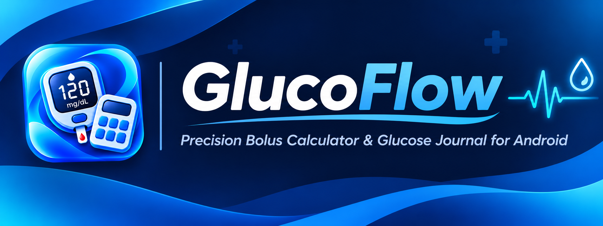

<!-- HERO WAVE BANNER -->

<!-- ANIMATED SUBTITLE -->

  

<!-- PRIMARY CTA & WEBSITE BADGES -->

 

<!-- LIVE RELEASE & APP SPEC BADGES -->

  

  <strong>GlucoFlow</strong> is a modern, clinical-grade Android diabetes companion combining a <strong>personalized 5-step bolus insulin calculator</strong>, a <strong>dual-mode blood glucose journal</strong>, multi-range glucose analytics, and doctor-ready PDF exports — all backed by instant Google Cloud Sync.

[Download APK](https://github.com/z0h1x/GlucoFlow/releases/latest) •
[Official Website](https://glucoflowapp.vercel.app) •
[Core Features](#-core-features) •
[Install Guide](#-download--install) •
[Report a Bug](https://github.com/z0h1x/GlucoFlow/issues)

---

## ✨ Core Features

<table>
  <tr>
    <td width="50%" valign="top">
      <h3>🧮 Guided 5-Step Bolus Calculator</h3>
        
      <ul>
        <li><strong>Prescribed to You</strong> — Configured around your 6 personal clinician values (Breakfast, Lunch & Dinner <code>CF</code> & <code>CR</code>) with zero hardcoded defaults.</li>
        <li><strong>Two Clinical Correction Modes</strong> — Supports both <code>mg/dL per 1 U</code> and <code>U per 10 mg/dL</code>.</li>
        <li><strong>Precision Device Rounding</strong> — Matches <code>1.0 U</code> standard pens, <code>0.5 U</code> pediatric pens, <code>0.1 U</code> insulin pumps, or custom increments.</li>
        <li><strong>Exact Clinical Units</strong> — Consistently tracks in <code>mg/dL</code>, grams (<code>g</code>), and insulin units (<code>U</code>).</li>
      </ul>
    </td>
    <td width="50%" valign="top">
      <h3>📓 Dual-Mode Glucose Journal</h3>
        
      <ul>
        <li><strong>Basic Monitoring Sheet</strong> — 7 structured daily time slots (<em>Before / 2h After Breakfast, Lunch, Dinner & Bedtime</em>) with color-coded range indicators.</li>
        <li><strong>Advanced Meal Logbook</strong> — Track pre-meal & 2h post-meal glucose, meal notes, carbs, insulin name, dose units, and injection time.</li>
        <li><strong>2-Hour Follow-Up Alerts</strong> — Highlights meals missing their 2h post-meal reading so nothing gets missed.</li>
        <li><strong>Daily, Weekly & Monthly Views</strong> — Includes an interactive monthly calendar heatmap and instant range summary.</li>
      </ul>
    </td>
  </tr>
  <tr>
    <td width="50%" valign="top">
      <h3>📈 Trends & Doctor-Ready PDF</h3>
        
      <ul>
        <li><strong>7-Day & Lifetime Overview</strong> — Visual glucose trend graphs and overall status indicators right inside Calculator and History.</li>
        <li><strong>Custom Date-Range PDF</strong> — Exports clean, clinic-ready logbook tables tailored for Basic or Advanced tracking.</li>
        <li><strong>One-Tap Share & Print</strong> — Save to your phone or share directly with your endocrinologist or care team.</li>
      </ul>
    </td>
    <td width="50%" valign="top">
      <h3>🛡️ Cloud Sync & Verified Updates</h3>
        
      <ul>
        <li><strong>One-Tap Google Sign-In</strong> — Automatic profile, insulin prescription, history, and journal backup across devices.</li>
        <li><strong>Offline Ready</strong> — Keep logging anywhere; changes sync automatically when you're back online.</li>
        <li><strong>Built-In Update Checker</strong> — Checks GitHub Releases directly inside Settings with automatic <code>SHA-256</code> integrity verification.</li>
        <li><strong>Multilingual & RTL</strong> — Complete interface in 🇬🇧 <strong>English</strong>, 🇫🇷 <strong>Français</strong>, and 🇲🇦 <strong>العربية (RTL)</strong>.</li>
      </ul>
    </td>
  </tr>
</table>

---

## 📱 Inside the App

| Tab | What You Can Do |
| :--- | :--- |
| 🧮 **Calculator** | View your active meal `CF` / `CR` / pen step telemetry, check your 7-day glucose trend, and launch a guided 5-step bolus calculation. |
| 📓 **Journal** | Switch seamlessly between **Basic** and **Advanced** logbooks across **Daily**, **Weekly**, and **Monthly** views, or generate a PDF report. |
| 🕒 **History** | Inspect past dose breakdowns (correction vs. food units), track lifetime glucose status, and manage saved calculations. |
| ⚙️ **Settings** | Customize your 6 prescribed ratios, pen/pump rounding, avatar photo, language (`EN` / `FR` / `AR`), updates, and direct WhatsApp support. |

---

## 📲 Download & Install

1. Open the [**Latest Release**](https://github.com/z0h1x/GlucoFlow/releases/latest) page.
2. Under **Assets**, tap **`GlucoFlow-v1.5.3-build8.apk`** to download.
3. Open the downloaded `.apk` file on your Android device (**Android 7.0+**) and allow installation if prompted.
4. Sign in with Google — your settings, history, and glucose journal sync automatically.

> [!IMPORTANT]
> **Updating from v1.5 or earlier?**
> From **v1.5.1+** onward, GlucoFlow uses the official package ID **`com.z0h1xx.glucoflow`**. Download the latest APK directly from Releases; on first launch, the app automatically checks for the older package and guides you to uninstall it so you don't keep duplicate apps. All of your cloud data remains safely synced in your Google account.

---

## 🧮 Clinical Calculation Transparency

<strong>Click to view the dosing formulas & rounding rules used inside GlucoFlow</strong>

 

| Component | `mg/dL per 1 U` Mode | `U per 10 mg/dL` Mode | Precision Rule |
| :--- | :--- | :--- | :--- |
| **Correction Dose** | `max(0, (Current - Target) / CF)` | `max(0, (Current - Target) × CF / 10)` | Independently rounded to your device step |
| **Meal Dose** | `(Carbs × CR) / 10` | `(Carbs × CR) / 10` | Independently rounded to your device step |
| **Total Suggested Dose** | `Correction + Meal` | `Correction + Meal` | Sum of independently rounded components |

- The **Glucose Journal** is 100% manual — it never auto-imports calculator estimates, keeping your clinic logbooks authentic.

---

## ⚠️ Medical Disclaimer

> GlucoFlow is a **diabetes decision-support and glucose logging tool** configured strictly with parameters prescribed by your healthcare provider. It does **not** provide medical advice or replace clinical judgment. Always confirm insulin doses and consult your endocrinologist or care team before changing any prescribed settings.

---

### 🌐 Links & Support

  

Designed & built by <strong>Zohir (@z0h1x)</strong> • © 2026 Zohir • GlucoFlow. All rights reserved.

